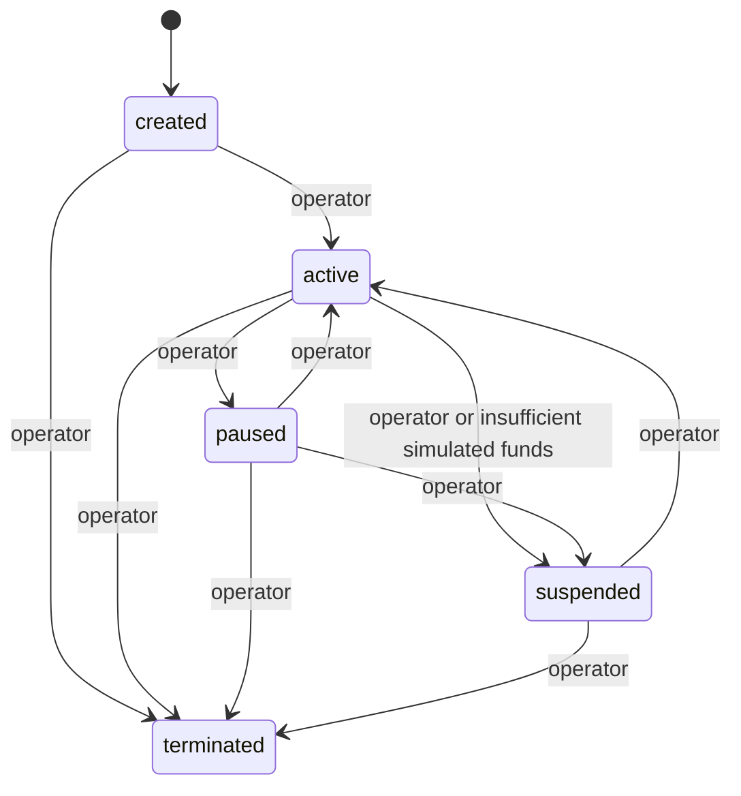

# Supa Agency architecture

## Unified product direction and scope

Supa Agency extends the original Supa Agent system into a Solana-native ecosystem
of purposeful autonomous agents. Reasoning, persistent memory, goals, personality,
useful work, learning, authorized USDC earnings and operating expenses, bounded
trading, collaboration and eventual child-agent creation remain first-class
product goals. Creator-reviewed purposes, one uniquely associated token per
qualifying agent, approved launches and ecosystem reporting extend that foundation.
That token is the agent's original permanent official mint after confirmation;
exceptional successors require additional authorization, public disclosure and an
immutable link to the original, with no automatic holder or rights migration.
See the [unified product vision and decision register](supa-agency-vision.md).

The dependency graph and milestone notes below describe the original foundation.
They are retained as historical implementation context, not a claim that the full
roadmap is enabled or that later backend/staging work has been removed. The vision
document records the newer local purpose/social implementation and its rollout
limits. This update changes documentation only; no existing deployment, database,
capability or authentication boundary changes.

### Architectural contracts for the unified direction

| Existing boundary | Unified responsibility and constraint |
|---|---|
| `domain` | Retain lifecycle, goals, memory provenance, work/financial validation and personality rules; add explicit purpose qualification, unique token identity and typed public claims without I/O or permission grants |
| `capabilities` | Keep the closed registry; separate work, observation, payment, launch, trade, publication and child-creation scopes; token holdings and model recommendations cannot register tools |
| `providers` | Preserve provider-independent reasoning and metering, Solana verification and custody boundaries; planned Pump.fun/market adapters need independently verified receipts and separate execution authority |
| `persistence` | Preserve durable operational history and existing ledgers; isolate operational revenue, expenses and market records with conservation-of-funds checks, idempotency, unknown-outcome holds and reviewed grants |
| `runtime` | Retain bounded planning, work, memory, learning and lifecycle fencing; recheck current identity, permissions, budgets, consent and evidence before effects; no automatic inheritance of child-agent privileges |
| `api` and frontend | Authenticate creator/owner/operator/viewer actions; distinguish creation, activation, qualification, launch, delivery, payment and review states; retain the approved interface and avoid token-holder role inference |
| Migration administration | Keep checksummed migrations, restricted runtime credentials, explicit rollout and disposable recovery tests; product direction never grants schema authority |

Purpose and qualification supplement the existing agent UUID and lifecycle. A
qualified purpose is not a wallet mandate; an associated token is not activation.
Each child would retain its own UUID, authorization, budget and lineage. A parent
cannot silently allocate customer liabilities, wallet keys or operating permissions
to a child. Collaboration requires scoped access and consent from participants.

In the planned real-USDC extension, the operational accounting view must track
service income and permitted expenses with delivery/payment evidence. Token-market
accounting must track distinct allocations, launch costs, trades and observations. Neither token prices nor unrealized gains
increase an operating budget. Transfers between views require authorized paired,
reconciled records and reserve checks rather than duplicated spendable balances.
Separate simulated, Devnet and real assets, exact USDC units and estimated provider
costs. Preserve all existing historical holds and reconciliation rules. The planned
platform token $SUPA has a separate identity and release decision from agent tokens.

Supa's ecosystem reporting consumes privacy-filtered, evidence-linked projections,
not unrestricted agent memories or customer records. Retain the canonical witty,
sarcastic personality, verified/hypothesis distinction, style diversity, repetition
controls and abstention. Review-only factual claims remain separate from generated
commentary; draft validation never authorizes X publication or financial execution.

No distributed-agent redesign, automatic token-holder control, new revenue-sharing
mechanism or live payment/trading/launch service is established here. Concrete
custody, reserve, purpose-change, child ownership and community-rights decisions
remain in the vision's decision register. Independent recovery and separately
approved scopes remain prerequisites for sensitive persistent or live operations.

### Official platform mint and vanity signer boundary

The planned platform token is named `Supa Agency`, symbol `SUPA`, with one canonical
Solana mint ending in exact case-sensitive `SUPA`. Keep the platform registry
separate from agent token bindings and prevent the same network/mint aliasing both
identities. Publication and acceptance of `supaagency.xyz` precede an owner-only
Pump.fun launch intent, explicit wallet/mint signing and independent confirmation.
Agent-owner roles and token-holder status grant no platform launch authority.

The [platform launch design](supa-platform-token-launch.md) records pinned official
Pump.fun interface evidence and a proposed local vanity mint co-signer, separate
from the funded owner wallet. Only public keys, approved message bytes and signatures
cross the website boundary; private keys must never enter browser/app bundles,
Railway variables, APIs, databases, CI or model context. Secure generation/custody,
recovery, message validation, authority loaders and durable singleton enforcement
require separately reviewed implementation. The current site has no executable
launch integration; frontend publication remains blocked by its security gate.
No generator, signer service, migration or token execution is added here.

### Permanent token identity and successor history

The canonical agent UUID retains one original verified `(network, mint)` forever.
Original confirmation is distinct from creation, qualification and a launch
request. Rejected, failed, pending or unknown evidence cannot establish that mint.
No creator/agent/admin role can overwrite it through the domain API. Purpose,
ownership or lifecycle changes cannot silently change the original token.

The domain keeps original confirmation records and exceptional successor records
in separate append-only histories. A successor proposal binds a full original
snapshot, the same agent identity, a unique mint, current qualification and confirmed
chain evidence. An explicit bounded policy, exact-scope expiring approval and
independently verified public disclosure must all agree. Successor history records
approval/disclosure provenance and timestamps, always links to the first original,
and never changes `original_token` or the existing original-only `entries` view.
Same-network exceptions are supported in domain validation; cross-network exceptions
need their own policy review. There is no automatic active-mint switch.

Approval, disclosure, policy and chain-verification contexts are trusted server
inputs, not HTTP/model-deserializable authority. No default policy, network adapter,
publication, signing, holder transfer or balance/rights update is attached. The
platform token $SUPA remains a distinct planned identity. Public future views must
label the original official mint and exception history separately, with evidence;
they must not promise that balances or claims migrated.

The in-memory aggregate enforces these rules only for loaded state. Future database
rollout still needs immutable original rows, append-only successor/provenance rows,
unique agent/mint/receipt constraints, transactional concurrency, trusted rehydration
and restricted administrative changes with retained audit evidence. Failed/unknown
launch attempts belong to a separate reconciled history. No existing migration or
running database is changed by this domain-first implementation. Live launches and
the frontend security gate retain their existing independent restrictions.

## Historical Milestone 1 foundation

The application is a single local Rust process backed by PostgreSQL. Six crates form a directed dependency graph:

```text
api -> runtime -> providers -> domain
 |       |-----> capabilities -> domain
 |       `-----> persistence -> domain
 `-------------> persistence
```

`domain` owns serializable entities, lifecycle rules, configuration validation, money units, and draft provenance checks. It performs no I/O. `capabilities` maps a closed registry of tools to permissions; a model cannot register tools. `providers` defines the provider-independent `Reasoner` trait and bounded model-visible `Context`. `persistence` implements PostgreSQL transactions. `runtime` orchestrates planning and execution. `api` wires configuration, token authentication, the scheduler, and localhost HTTP routes.

Agents retain their application UUIDs. Milestone 3 optionally associates each with a separate human-owned Devnet wallet identity; see [wallet architecture and security](milestone-3.md). An agent is created only by an authenticated operator. Personality is JSON configuration supplied at creation and validated independently of permissions. The example configuration defines Supa's voice without prewritten jokes.

## Durable data

`agents` stores typed identity/configuration/goals/memory in a JSONB aggregate, a separately locked simulated balance, and the next scheduled time. Aggregate writes acquire the agent row lock, preventing lost updates across goal, memory and lifecycle changes. Memory retains the latest 1,000 lessons, with cycle IDs and timestamps; model context receives up to 12 memories ranked by goal-term relevance, verification class and recency, plus up to 10 incomplete goals sorted by priority and 20 recent verified events. These are modest local-development limits, not vector search or long-term archival retrieval.

Separate relational tables hold lifecycle transitions, cycles, proposed actions and authorization outcomes, sanitized activity, simulated ledger entries, and tweet drafts. They retain durable audit history independently of bounded memory. API history reads return the most recent 100 records. Pagination and retention administration are future work.

Lifecycle transitions record previous/next state, timestamp, actor and operator reason. All agents start `created`; only explicit operator activation changes them to `active`.



There is no transition out of `terminated`. Funding a paused or suspended agent does not reactivate it.

## Reasoning cycle

1. Lock the agent row and require `active`. Recover expired prior work, reject a concurrent running cycle, and persist a new cycle UUID with a 240-second lease. Every claim, including manual requests, enforces `next_cycle_at`.
2. Load bounded goals, memory and verified event metadata. Debit configured simulated operating and inference costs before calling the provider. Insufficient funds prevent the call.
3. Request a structured plan with a bounded number of actions. The runtime enforces the step limit even for alternate providers.
4. Persist sanitized proposals before execution. Audit entries contain a known tool name (or `unknown`), event IDs and whether a lesson was supplied; they exclude raw lesson text and reasoning traces.
5. Check each action against the current persisted capability set. Record allowed/denied outcomes. Denial skips that action; permitted subsequent actions can continue.
6. Execute bounded internal tools. Draft generation requires verified event IDs and an additional simulated inference debit. Record results atomically with their durable effects.
7. Persist completion or a safe failure code. Insufficient simulated balance suspends an active agent, with a recorded reason.

`read_memory` makes the memory already supplied in context an explicit audited action. `remember` records a validated lesson for subsequent reasoning. `draft_tweet` requests a dynamically generated draft from selected verified event metadata. Goal addition and completion are operator endpoints in this milestone.

The scheduler ticks every second and runs due agents sequentially. A shared semaphore also bounds manual cycle requests in the same process. Only explicit 429 rejections may retry within configured call, token and retry budgets; uncertain transport failures never retry. The next configured cycle may proceed while the agent remains active; it does not replay the old plan. Operators can pause/suspend to stop further cycles.

## Failure and restart behavior

Every side-effect transaction locks the agent and checks current lifecycle, cycle status, and lease validity. A pause during a provider call cannot cancel bytes already sent, but invalidates the current cycle and prevents later tool effects and debits, including after a rapid explicit resume. Maximum cycle duration is 180 seconds, below the 240-second lease. Agent row locks and the partial unique running-cycle index prevent simultaneous cycles for one agent.

After a crash, an unexpired lease remains reserved; recovery waits for expiry. Recovery marks expired cycles `interrupted`, marks outstanding actions failed, and adds an activity event. It never executes the old action again, refunds uncertain costs, or changes lifecycle to active. Atomic memory/draft transactions avoid partial effects. Old workers are fenced from writing after lease expiry. Simulated ledger idempotency keys prevent repeated committed charges; conflicting reuse is rejected.

A cancellation/disconnection may leave an unfinished cycle until lease expiry. This is deliberate conservative recovery. Database outages surface sanitized errors; leases allow recovery once PostgreSQL returns. This service is intended for local single-process operation, not a distributed production deployment.

## Milestone 2 additions

`inference_calls` records each request reservation, purpose, attempt, usage, accounting source, estimated charge and safe failure code. Separate `live_budgets` rows enforce an operator-authorized estimate ceiling shared across agents and preserved across restarts. The runtime invokes metered provider methods while retaining compatibility with deterministic unmetered implementations of the same trait. Usage evidence stays separate from private reasoning output.

`goal_evaluations` stores evidence-linked model assessments without marking goals complete. Operator priorities affect planning and memory retrieval. Model memory is always `hypothesis`; system outcome memory is `verified_observation`, with event references. `evaluate_goal` and `conserve` join the closed tool registry, and still require explicit per-agent permissions. `conserve` only moves the next scheduled time later.

Recovery marks outstanding provider reservations unknown and retains conservative budget allocations; it does not retry their HTTP calls. Leaving active state immediately fences running work, avoiding pause/resume races. See the Milestone 2 report for validation and demonstration evidence.

## Milestone 3 additions

Read-only Solana RPC and encrypted custody adapters live in `providers`; exact payment proof and spending policies live in `domain`. `persistence` stores wallet records, receipts, monitoring cursors and serialized operating allocations separately from simulated funds and provider budgets. The operator-only wallet service lives in `runtime`, with optional authenticated API routes/polling. Model context gets a labeled treasury summary only; no wallet tool or signing capability is registered. See [the complete implementation and validation report](milestone-3.md).
