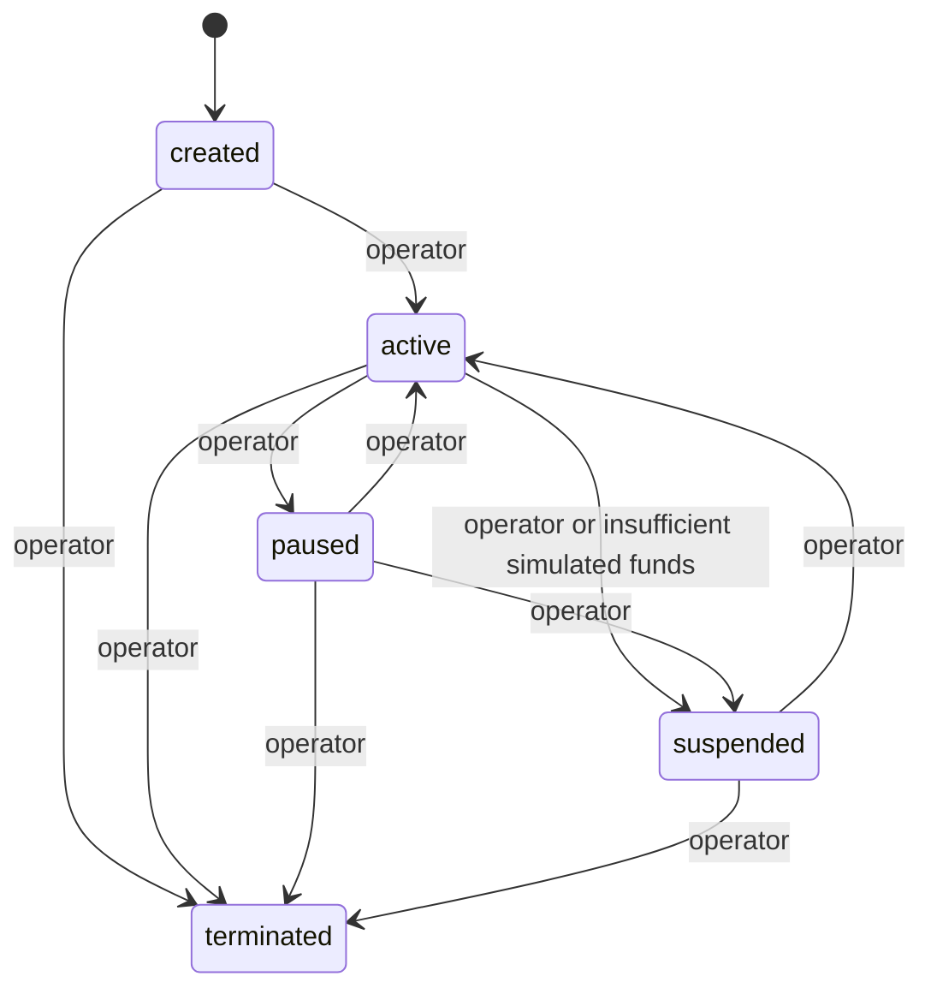

# Milestone 1 architecture

The application is a single local Rust process backed by PostgreSQL. Six crates form a directed dependency graph:

```text
api -> runtime -> providers -> domain
 |       |-----> capabilities -> domain
 |       `-----> persistence -> domain
 `-------------> persistence
```

`domain` owns serializable entities, lifecycle rules, configuration validation, money units, and draft provenance checks. It performs no I/O. `capabilities` maps a closed registry of tools to permissions; a model cannot register tools. `providers` defines the provider-independent `Reasoner` trait and bounded model-visible `Context`. `persistence` implements PostgreSQL transactions. `runtime` orchestrates planning and execution. `api` wires configuration, token authentication, the scheduler, and localhost HTTP routes.

Agents retain their application UUIDs. Milestone 3 optionally associates each with a separate human-owned Devnet wallet identity; see [wallet architecture and security](milestone-3.md). An agent is created only by an authenticated operator. Personality is JSON configuration supplied at creation and validated independently of permissions. The example configuration defines Supa's voice without prewritten jokes.

## Durable data

`agents` stores typed identity/configuration/goals/memory in a JSONB aggregate, a separately locked simulated balance, and the next scheduled time. Aggregate writes acquire the agent row lock, preventing lost updates across goal, memory and lifecycle changes. Memory retains the latest 1,000 lessons, with cycle IDs and timestamps; model context receives up to 12 memories ranked by goal-term relevance, verification class and recency, plus up to 10 incomplete goals sorted by priority and 20 recent verified events. These are modest local-development limits, not vector search or long-term archival retrieval.

Separate relational tables hold lifecycle transitions, cycles, proposed actions and authorization outcomes, sanitized activity, simulated ledger entries, and tweet drafts. They retain durable audit history independently of bounded memory. API history reads return the most recent 100 records. Pagination and retention administration are future work.

Lifecycle transitions record previous/next state, timestamp, actor and operator reason. All agents start `created`; only explicit operator activation changes them to `active`.



There is no transition out of `terminated`. Funding a paused or suspended agent does not reactivate it.

## Reasoning cycle

1. Lock the agent row and require `active`. Recover expired prior work, reject a concurrent running cycle, and persist a new cycle UUID with a 240-second lease. Every claim, including manual requests, enforces `next_cycle_at`.
2. Load bounded goals, memory and verified event metadata. Debit configured simulated operating and inference costs before calling the provider. Insufficient funds prevent the call.
3. Request a structured plan with a bounded number of actions. The runtime enforces the step limit even for alternate providers.
4. Persist sanitized proposals before execution. Audit entries contain a known tool name (or `unknown`), event IDs and whether a lesson was supplied; they exclude raw lesson text and reasoning traces.
5. Check each action against the current persisted capability set. Record allowed/denied outcomes. Denial skips that action; permitted subsequent actions can continue.
6. Execute bounded internal tools. Draft generation requires verified event IDs and an additional simulated inference debit. Record results atomically with their durable effects.
7. Persist completion or a safe failure code. Insufficient simulated balance suspends an active agent, with a recorded reason.

`read_memory` makes the memory already supplied in context an explicit audited action. `remember` records a validated lesson for subsequent reasoning. `draft_tweet` requests a dynamically generated draft from selected verified event metadata. Goal addition and completion are operator endpoints in this milestone.

The scheduler ticks every second and runs due agents sequentially. A shared semaphore also bounds manual cycle requests in the same process. Only explicit 429 rejections may retry within configured call, token and retry budgets; uncertain transport failures never retry. The next configured cycle may proceed while the agent remains active; it does not replay the old plan. Operators can pause/suspend to stop further cycles.

## Failure and restart behavior

Every side-effect transaction locks the agent and checks current lifecycle, cycle status, and lease validity. A pause during a provider call cannot cancel bytes already sent, but invalidates the current cycle and prevents later tool effects and debits, including after a rapid explicit resume. Maximum cycle duration is 180 seconds, below the 240-second lease. Agent row locks and the partial unique running-cycle index prevent simultaneous cycles for one agent.

After a crash, an unexpired lease remains reserved; recovery waits for expiry. Recovery marks expired cycles `interrupted`, marks outstanding actions failed, and adds an activity event. It never executes the old action again, refunds uncertain costs, or changes lifecycle to active. Atomic memory/draft transactions avoid partial effects. Old workers are fenced from writing after lease expiry. Simulated ledger idempotency keys prevent repeated committed charges; conflicting reuse is rejected.

A cancellation/disconnection may leave an unfinished cycle until lease expiry. This is deliberate conservative recovery. Database outages surface sanitized errors; leases allow recovery once PostgreSQL returns. This service is intended for local single-process operation, not a distributed production deployment.

## Milestone 2 additions

`inference_calls` records each request reservation, purpose, attempt, usage, accounting source, estimated charge and safe failure code. Separate `live_budgets` rows enforce an operator-authorized estimate ceiling shared across agents and preserved across restarts. The runtime invokes metered provider methods while retaining compatibility with deterministic unmetered implementations of the same trait. Usage evidence stays separate from private reasoning output.

`goal_evaluations` stores evidence-linked model assessments without marking goals complete. Operator priorities affect planning and memory retrieval. Model memory is always `hypothesis`; system outcome memory is `verified_observation`, with event references. `evaluate_goal` and `conserve` join the closed tool registry, and still require explicit per-agent permissions. `conserve` only moves the next scheduled time later.

Recovery marks outstanding provider reservations unknown and retains conservative budget allocations; it does not retry their HTTP calls. Leaving active state immediately fences running work, avoiding pause/resume races. See the Milestone 2 report for validation and demonstration evidence.

## Milestone 3 additions

Read-only Solana RPC and encrypted custody adapters live in `providers`; exact payment proof and spending policies live in `domain`. `persistence` stores wallet records, receipts, monitoring cursors and serialized operating allocations separately from simulated funds and provider budgets. The operator-only wallet service lives in `runtime`, with optional authenticated API routes/polling. Model context gets a labeled treasury summary only; no wallet tool or signing capability is registered. See [the complete implementation and validation report](milestone-3.md).
